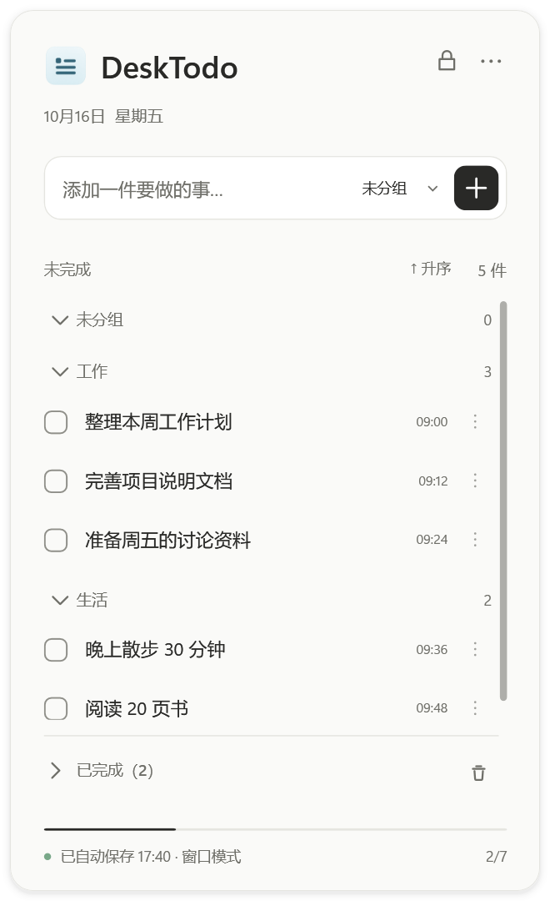
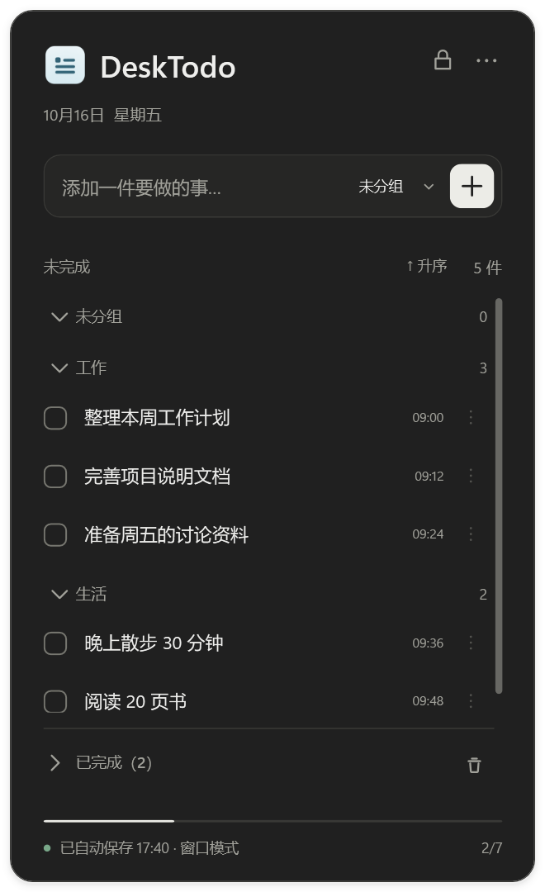
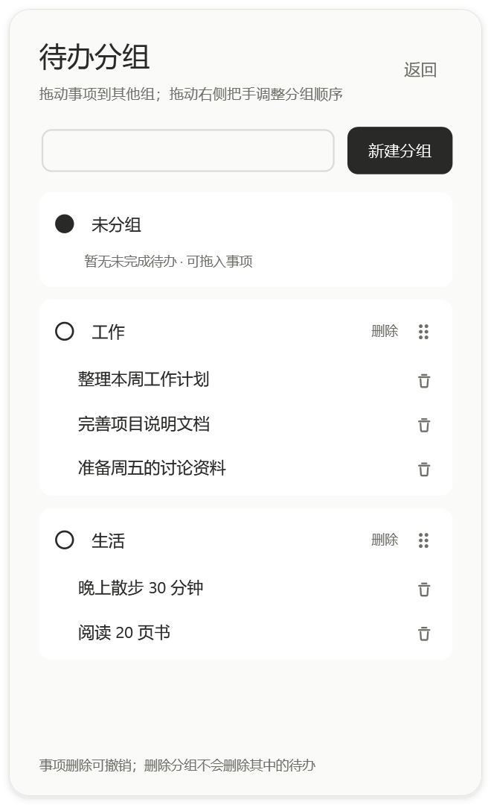
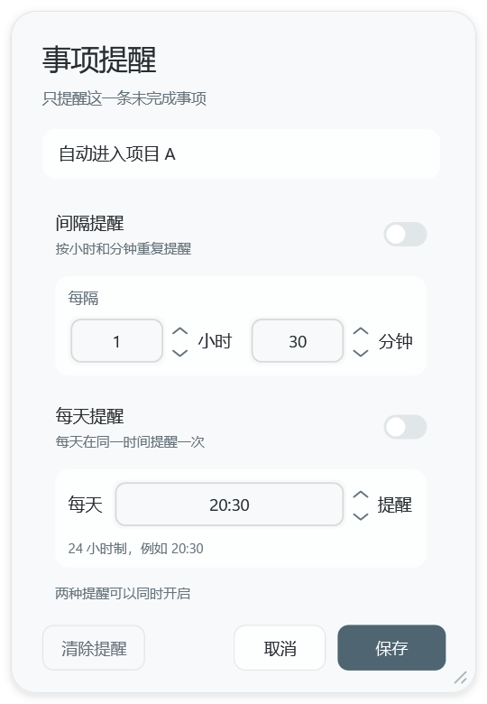
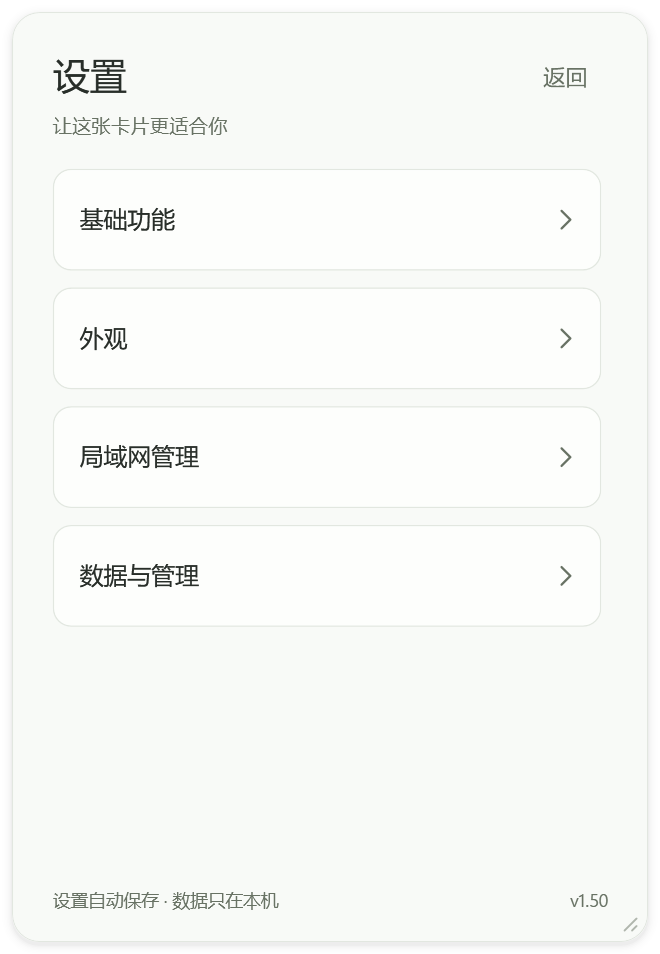
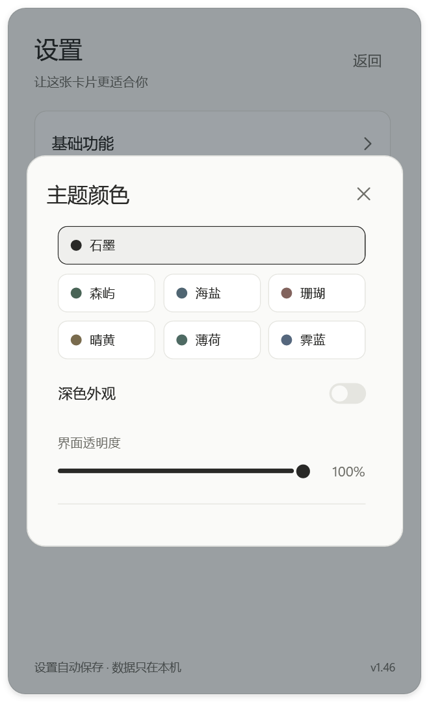

<p align="center"></p>
<h1 align="center">DeskTodo</h1>
<p align="center">一张安静留在桌面上的待办卡片。把事情记下来，按自己的节奏完成。</p>
<p align="center"><a href="https://github.com/1242483743/DeskTodo/releases">v1.46</a> · Windows 10 / 11 x64 · <a href="LICENSE">MIT 开源</a> · 默认本地保存，无需账号</p>
<p align="center"><a href="https://github.com/1242483743/DeskTodo/releases">下载安装版</a> · <a href="https://github.com/1242483743/DeskTodo/releases">下载免安装版</a> · <a href="https://github.com/1242483743/DeskTodo/releases/latest">最新发布</a> · <a href="使用说明.md">使用说明</a></p>

## 界面预览

保留简洁的卡片框架，用细线控件、低饱和配色和统一的文字对齐，让待办清单更耐看。

<p align="center"> </p>
<p align="center">浅色与深色主页 · 截图均来自 v1.46，内容为演示数据，不含个人待办</p>

## 能做什么

- **桌面上的待办卡片**：可嵌入桌面，也可作为独立窗口；支持拖动、八方向调整大小、锁定，以及可贴边半隐藏的悬浮入口。
- **把事情分好组**：创建、重命名、置顶、折叠分组；在主页直接将事项拖到其他组，拖动整组调整顺序，也可关闭分组后自由排序。
- **清单操作顺手**：勾选完成、双击编辑、点击编辑框外确认；支持置顶、时间升降序、手动排序、删除撤销与二次确认清空已完成。
- **每件事独立提醒**：为单条待办设置间隔提醒或每天指定时间提醒，支持稍后提醒；提醒需软件持续运行。
- **外观随你调整**：石墨、森屿、海盐等七套低饱和主题，均支持浅色与深色；可修改透明度、名称、界面按钮以及事项时间、月日显示。
- **双屏使用更协调**：处理不同缩放比例的跨屏移动；可选“仅连接副屏时自启”，在所选副屏恢复上次位置，此选项默认关闭。
- **本地保存与备份**：自动保存、导入导出 JSON 备份、托盘与开机自启、可自定义全局快捷键。
- **可选局域网管理**：同一可信局域网内，管理员可通过管理口令查看和维护多个用户的共享待办、分组和提醒；共享默认关闭，无需公网服务器。

<p align="center"> </p>
<p align="center">分组管理与独立提醒</p>

<p align="center"> </p>
<p align="center">设置分类与主题偏好</p>

## v1.46 更新重点

- **减少设置点击停顿**：普通外观设置即时生效，连续操作合并后在后台原子写盘，不再每点一下就让界面等待磁盘。
- **减少重复创建界面**：时间、日期和主题更新保留现有待办行；透明度滑块只更新透明度，不重建整套主题资源。
- **减少重复查询**：缓存自启状态和副屏选项，在打开设置或显示器发生变化等必要时机刷新。
- **保存状态更准确**：区分保存中、成功和失败；防止旧后台快照覆盖较新的修改，隐藏和退出时仍检查并保存最新数据。

本版在本地独立环境通过 **820 项应用检查与 49 项安装器检查**，覆盖保存竞态、慢磁盘、窗口重建、跨屏、拖动、提醒、托盘及安装回滚等场景。实际流畅度也会受到电脑配置、显示设置与后台程序影响。

从 v1.22 升级还包含新的视觉配色、分组拖放、局域网管理、全局快捷键、副屏启动条件及混合 DPI 修复等后续改进，详见[使用说明](使用说明.md)。

## 下载与安装

> v1.46 的源码和演示图片已更新，安装包附件尚在上传，**目前还没有正式发布 v1.46 成品**。以下下载入口暂时指向现有发布列表（当前为 v1.22），待附件核验完成后再切换到 v1.46。

| 下载文件 | 用途 |
| --- | --- |
| [DeskTodo-Setup-v1.46.exe](https://github.com/1242483743/DeskTodo/releases) | 推荐：带安装向导、开始菜单及可选桌面快捷方式 |
| [DeskTodo-v1.46.zip](https://github.com/1242483743/DeskTodo/releases) | 免安装：完整解压后运行 `DeskTodo.exe`，保留旁边的配置文件 |
| [SHA256SUMS.txt](https://github.com/1242483743/DeskTodo/releases) | 核对安装包和免安装包是否下载完整 |

系统要求：Windows 10 / 11 **64 位**，.NET Framework **4.8**。

首次安装可选择路径，默认 `C:\Program Files\DeskTodo`；下一页选择开始菜单和桌面快捷方式。写入受保护目录时，Windows 会请求管理员权限。

**覆盖更新前，请先保存正在编辑的内容并退出旧版，再安装到原位置。** 安装器会检测已有安装并保留本机待办数据。建议先从软件设置中导出一份备份。

GitHub 自动生成的 `Source code (zip)` / `Source code (tar.gz)` 是源码归档，**不是可直接运行的软件**。旧 v1.22 发布标签可能只包含当时的介绍文件；完整新版源码见 `main` 分支和 v1.46 标签。安装包未提供数字签名，文件哈希用于一致性校验，不代表数字签名。

## 数据与使用边界

- 默认无需账号，待办只保存在本机；本地使用不依赖公网服务器。
- 只有主动启用局域网共享，持有本机管理口令的管理员才能在同一局域网内读取或修改共享待办。请仅在可信网络使用，不要将端口映射到公网，也不要向无关人员分享管理口令。
- 关闭共享不影响本地待办。新旧版本协同使用时，建议管理员端与用户端均升级到最新版。
- 隐藏到托盘仍可提醒；完全退出、电脑关机时无法提醒。删除、导入和升级前，建议定期导出备份。

## 从源码构建

在 Windows PowerShell 5.1 和 .NET Framework 4.8 环境下运行，使用系统 C# 编译器，无需下载第三方依赖包。

```powershell
git clone https://github.com/1242483743/DeskTodo.git
cd DeskTodo
powershell.exe -NoProfile -ExecutionPolicy Bypass -File .\build.ps1
powershell.exe -NoProfile -ExecutionPolicy Bypass -File .\build-setup.ps1 -AppDirectory dist
```

应用输出到 `dist\DeskTodo.exe`，安装包输出到 `release\DeskTodo-Setup-v1.46.exe`。也可用 Visual Studio 打开 `src\DesktopTodo.csproj`，需要 .NET Framework 4.8 开发工具。

运行自检：

```powershell
powershell.exe -NoProfile -ExecutionPolicy Bypass -File .\build.ps1 -Test
powershell.exe -NoProfile -ExecutionPolicy Bypass -File .\build-setup.ps1 -AppDirectory dist -Test
```

自检创建独立数据与临时窗口，结果写入 `qa`。请在有可交互桌面的 Windows 会话中运行；显示器组合不同，部分实机检查范围也不同。真实受保护目录安装及 UAC 仍需实际验证。不要将测试输出或个人待办文件提交到仓库。

```text
src/                    应用源码、WPF 界面与自检
installer/              安装器源码与界面
图标/                   程序和软件内图标资源
docs/images/            v1.46 演示截图
build.ps1               编译应用
build-setup.ps1         构建安装包
build-icon.ps1          导出多尺寸透明 ICO
organize-versions.ps1   整理本地当前版本和历史成品
使用说明.md              完整使用说明
LICENSE                 MIT 许可证
```

成品放在 Releases，不把安装包、备份、测试数据或个人待办纳入源码管理。

## 反馈与许可证

欢迎通过 [Issues](https://github.com/1242483743/DeskTodo/issues) 反馈问题。请附软件版本、Windows 版本及复现步骤；跨屏问题请同时说明显示器分辨率与缩放比例。截图前请遮挡个人信息。

源码采用 [MIT 许可证](LICENSE)，版权署名 `1242483743`；使用、修改或分发时请保留版权声明和许可证。
